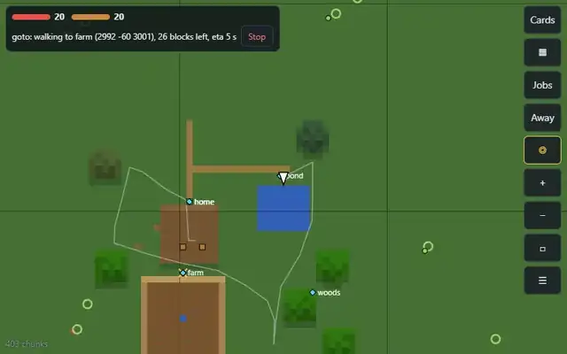
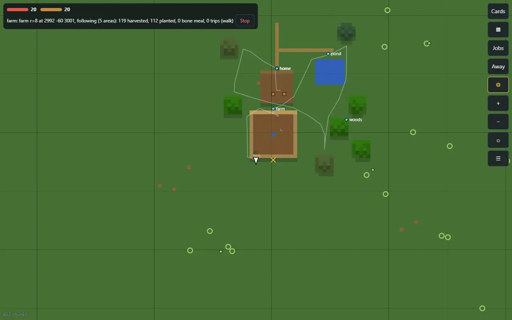
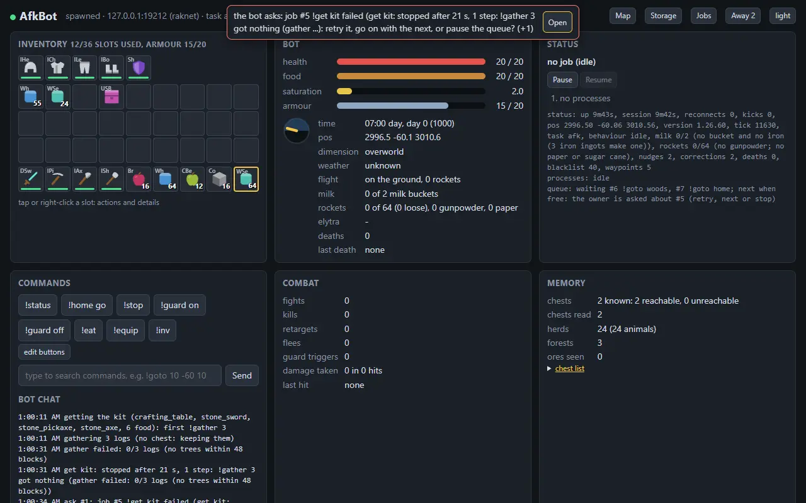
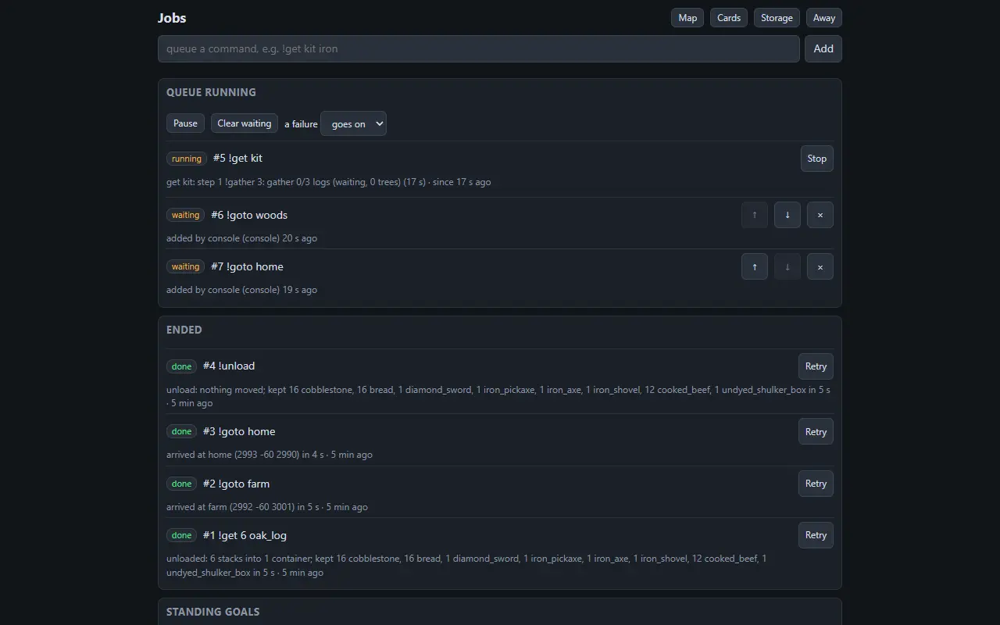
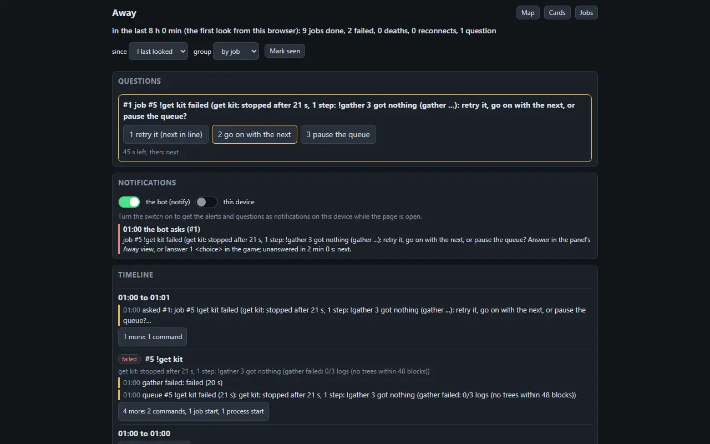

# BedrockBot

A bot for Minecraft **Bedrock Edition**, written in TypeScript for Node 24. It joins a server as an ordinary
network client, with no mod and no game client: a Realm (with its own Microsoft account) or a Bedrock Dedicated
Server in offline mode. Its owners command it from the game's chat, from a control panel in the browser, or from
Discord.



<!-- MEDIA PLACEHOLDER (shot list: in-game 1, a flight home with the elytra, 10 to 20 s): docs/media/game-flight.webp -->

## What it does

- **Stays online**: keeps an account on a Realm (24-hour stays measured), reconnects with backoff, respawns,
  walks home.
- **Moves like a player**: its own Bedrock physics and pathfinding; doors, trapdoors, water, long falls within a
  health budget, a water-bucket clutch; elytra flight over long trips when it carries an elytra and rockets.
- **Survives**: eats, wears its best armour, spares worn tools, fights hostile mobs in reach, flees when hurt,
  waits out the night in a shelter or a bed. It never attacks a player, under any command.
- **Works**: `!get <item>` gathers wood, mines ore, hunts, farms or crafts, whichever the item needs; from an
  empty inventory on a fresh world it makes its own first kit. It builds from its own blocks, quarries, tunnels,
  smelts and cooks.
- **Keeps house**: remembers the chests around home and what is in them, unloads into them, brings things back
  (`!bring`), boxes full stacks into shulker boxes.
- **Remembers**: the world it has seen, waypoints and every job and event, across restarts.
- **Runs a queue**: jobs one after another while you are away; a timeline of what happened, and questions it
  asks you when a job fails.

Honest limits: it is tested on local servers and one Realm, mostly in the overworld; the Nether is
survivable but lightly tested and the End is read-only; it has no combat against players at all; a run on a
real survival world still ends in a death now and then ([early-game.md](docs/early-game.md) counts them).

**Off by default, and why.** Anything that changes the world in a way you might not want, sends something off
your machine, or has not been proven on real terrain ships off:

| Off | What it does when on | Why off |
|---|---|---|
| `allowBreak`, `allowPlace` | a walk digs through blocks and pillars up | a walk could dig into your build; jobs you give it (`!mine`, `!quarry`, `!build`) dig and place anyway |
| `notify`, `notifyDiscord`, `discordBot` | notes to the panel, a Discord webhook, a Discord bot | they change what leaves the machine |
| `askOwner` | a failed queued job asks you what to do | the queue would wait for an answer |
| `!do` (no `nl` block) | plain-language commands through a local model | needs Ollama on the machine |
| `fleeFly`, `sealIn`, `mobDodge`, `nightShell`, `autoMend`, `farmFood`, `autoBreed` and others | elytra escapes, walling in, chores | each can cost blocks, items or the bot's life until proven on your terrain |

On by default, because a player would do them: eating, wearing armour, sleeping in a known bed, hunting food
animals by day when it carries little food (`autoFood`), unloading into the chests at home (`autoUnload`),
striking hostiles in reach (`mobReflex`), and flying long trips when it carries the kit (`autoFly`).
`!help settings` in the game lists every setting with its value; `!set <name> off` turns one off.

## What it needs

- **Node 24** or newer and **pnpm** through corepack (`corepack enable`)
- **Docker Desktop**, only for the local test server
- on Windows a short clone path, such as `C:\code\BedrockBot`
- a server: the local test server, your own BDS in offline mode, or a Realm and a second Microsoft account
  for the bot
- Minecraft Bedrock, optional: to see the bot and talk to it in chat

## Quick start

```sh
git clone <this repository> BedrockBot && cd BedrockBot
corepack enable
pnpm install
pnpm config:init                            # a config file outside the repository; prints the panel token once
pnpm bot:check                              # Node, the install, the config: what to fix, one line each
pnpm bds:up                                 # the local test server, BDS in Docker on udp/19132
pnpm bot:afk -- --walk --health-port 9464   # "spawned as AfkBot"
```

Put your gamertag into `owners` in the config file before you start, so the bot takes your commands.
[docs/getting-started.md](docs/getting-started.md) walks through every step and what to do when one fails.

| Server | Works? | How |
|---|---|---|
| The local test server (BDS in Docker) | yes, the tested path | `pnpm bds:up`, then join `127.0.0.1` port 19132 from the game |
| Your own BDS | yes, offline mode only | `online-mode=false` and `allow-list=false`; config `host` / `port` ([safety](#safety)) |
| A Realm | yes | a separate Microsoft account invited to the Realm; `pnpm bot:realm`; a device-code sign-in you do once |
| A world hosted from the game (LAN) | no | it checks every joiner's Xbox sign-in, and the bot signs in only for a Realm |

## First commands

As an owner in the game's chat, or from the server console (`pnpm bds:cmd say !status`):

| Command | What happens |
|---|---|
| `!help` | the nine commands most owners need; `!help all`, `!help <command>` |
| `!status` | what it is doing, where it is |
| `!come` | walks to you (`coming to <you>`, then `here (<you>)`) |
| `!home set` | the point it returns to after a death and at dawn |
| `!get 8 oak_log` | gathers, mines, hunts or farms for the item |
| `!queue add <command>` | lines up jobs to run one after another |
| `!stop` / `!quit` | stops what it runs / disconnects |

Every command: [docs/commands.md](docs/commands.md).

<!-- MEDIA PLACEHOLDER (shot list: in-game 3, the first day from an empty inventory, 15 to 20 s): docs/media/game-early.webp -->

## The control panel

With a health port the bot serves a page on your network: a live map, the inventory, storage, a job queue and
an away view with a timeline. Shots from a test world:

| Map | Inventory and status | Jobs | Away |
|---|---|---|---|
|  |  |  |  |

On a phone: [map](docs/media/phone-map.webp), [inventory](docs/media/phone-cards.webp),
[jobs](docs/media/phone-jobs.webp), [away](docs/media/phone-away.webp); storage:
[desktop](docs/media/panel-storage.webp). Guide: [docs/panel.md](docs/panel.md).

<!-- MEDIA PLACEHOLDER (shot list: in-game 5, a Discord command and its reply on a phone, 10 to 15 s): docs/media/discord-phone.webp -->

## Safety

- **What it can break.** Jobs you give it dig and place: `!mine`, `!quarry`, `!tunnel`, `!build`, `!farm`,
  `!get`. Walks do not dig through or build up unless `allowBreak` / `allowPlace` are on, except a short way
  dug through natural blocks to avoid a fall that hurts (`digWay`). Nothing is dug within `protectRadius` (48)
  of home, and blocks it recognises as built are never dug anywhere. It never attacks players, pets,
  villagers or golems. `!get` makes new things and never takes from your chests; `!bring` does, when you ask.
- **The owners list.** Only names in `owners` (and the server console, unless `consoleOwner` is false) command
  it. On an offline server names are not checked by anyone: whoever reaches the port can join under an owner's
  name. Keep such a server on your own machine or LAN, never forwarded to the internet.
- **The panel token.** The panel can make the bot walk, dig and drop items. It listens on `127.0.0.1` unless
  you set a network host, and then only with a token. Keep it on your LAN or VPN; never forward its port.
- **The Discord door.** Off by default (`discordBot`). When on, only the Discord user ids in `discordUsers`
  command it, only in the channels you list or a direct message; `!quit`, `!test`, `!learn` and the Discord
  settings themselves are refused from Discord. The token stays in an environment variable or a file outside
  the repository ([docs/discord.md](docs/discord.md)).
- **A Realm.** Use a separate account and tell everyone who plays there. The sign-in is a device code you enter
  in a browser; the bot never sees a password; its tokens are cached outside the repository.
- **Secrets.** The config file, the token cache, `discord-webhook.url` and `discord-bot.token` live outside
  the repository; `pnpm bot:check` says whether they exist and never prints them. Packet captures in
  `bot/logs/` contain chat and names: keep them private.

<!-- MEDIA PLACEHOLDER (shot list: in-game 2, digging out of a cave to open sky, 10 to 20 s; in-game 4, a fight at night, 5 to 15 s): docs/media/game-cave.webp, docs/media/game-fight.webp -->

## Documentation

[docs/README.md](docs/README.md) lists every guide, grouped (getting started, playing, the panel and away mode,
Discord, how it works inside, contributing), and every design decision. [PLAN.md](PLAN.md) holds the plan,
the verified facts and the risks; [docs/runbook.md](docs/runbook.md) every flag, server and test.

## Tests

```sh
pnpm lint
pnpm test                                     # the default unit run: pure logic and recorded packets, no server
pnpm test:perf                                # wall-clock bounds (vitest project "perf"), on an idle machine only
BDS_E2E=1 pnpm --filter bot test:e2e          # end to end, against the local servers in Docker
```

The default unit run needs no server, no config and no network, and must pass on a busy machine: it has no time
bounds (they are in the perf project) and the planners count work instead of milliseconds. CI (`.github/workflows/ci.yml`)
runs on every push and pull request: a frozen install, `pnpm lint`, `pnpm test`, the docs index check and
`pnpm bot:check -- --no-config`; not the perf project or the end-to-end suites. [docs/testing.md](docs/testing.md) has
the rules; the end-to-end suites and their servers are in [docs/runbook.md](docs/runbook.md) "Tests".

## Licence

MIT, see [LICENSE](LICENSE), except the two folders ported from Baritone (`bot/src/skills/nav/baritone/`,
`bot/src/skills/mine/baritone/`), which are LGPL-3.0; [THIRD_PARTY_NOTICES.md](THIRD_PARTY_NOTICES.md) lists
them and the other third-party material.

No Minecraft art is part of this repository. The control panel can show the game's item pictures, which it
draws at run time from the optional `minecraft-assets` npm package (`pnpm install --no-optional` leaves it
out, and the panel then falls back to drawn glyphs, as in the shots above); see docs/panel.md.

Minecraft is a trademark of Mojang AB. This is an independent project, not approved by or associated with
Mojang or Microsoft.
