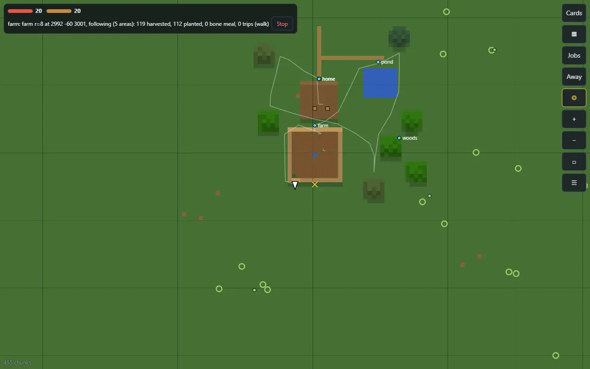

# Getting started: from a fresh clone to the first commands

This guide is for someone who has never run the bot. It takes about 10 minutes on a machine that has Node and
Docker, most of it downloads. The [runbook](runbook.md) has every option; this page has the path that works first
time, and where a newcomer usually stops.

## What you need

| What | Why |
|---|---|
| **Node 24 or newer** (`node --version` prints `v24...`; `.nvmrc` says 24) | the bot is TypeScript that Node 24 runs directly, with no build step |
| **pnpm through corepack** (`corepack enable`, once per machine) | the repository pins one pnpm version in `package.json`; corepack fetches it from the npm registry the first time, so that first call needs the network |
| **git** | to clone |
| **Docker Desktop**, Linux containers (only for the local test server) | `pnpm bds:up` runs Bedrock Dedicated Server (BDS) in a container; skip it if you point the bot at a server you run yourself or at a Realm |
| about 1 GB of disk | node_modules is about 400 MB, each BDS download about 100 MB |
| on Windows, a short clone path (`C:\code\BedrockBot`) | pnpm's files under `node_modules` reach about 200 characters below the clone; past Windows' 260-character limit the install fails |
| Minecraft Bedrock on any device (optional) | to see the bot and type to it in chat; without it you can still command it from the server console or the panel |

## Install

```sh
git clone <this repository> BedrockBot
cd BedrockBot
corepack enable
pnpm install          # about a minute; applies the patches under patches/ to two libraries
pnpm bot:check        # checks Node, pnpm, the install and the patches; it says what to fix
```

`pnpm bot:check` (also `node bot/src/doctor/cli.ts`) never changes anything and never contacts any outside
service. Run it again after each step below; each problem it finds has a one-line fix under it.

## Before the first start

`pnpm config:init` writes a commented config file **outside the repository** and prints the control panel's
token once:

- Windows: `%LOCALAPPDATA%\bedrockbot\config.json`
- macOS and Linux: `~/.bedrockbot/config.json`
- elsewhere: `pnpm config:init --path <file>` and start the bot with `--config <file>` or `BEDROCKBOT_CONFIG=<file>`

It refuses a path inside the repository, because the file names your account and holds the panel token. Edit
two things in it:

1. **`owners`**: your gamertag (or `"xuid:<id>"`). Only owners' chat commands run; the server console counts as
   an owner unless `"consoleOwner": false`. The example's `YourGamertag` matches nobody.
2. **`host` / `port`**, if the server is not the local test server on `127.0.0.1:19132`.

`"walk": true` is already in the example: it turns on the movement stack. Without it the bot stands where it
spawns, and `!come`, `!goto` and `!get` answer `come needs a task that can walk`. The command-line flag `--walk`
does the same. With no config file walking stays off for a local server (on for a Realm): the AFK soaks and the
keepalive test run `--task afk` that way to measure the keepalive alone, and there is no flag to turn it off again.

Settings you change in the game with `!set` are saved in `settings.json` next to the config file; the world
cache, the event history and the waypoints live there too. Nothing the bot writes goes into the repository
except logs under `bot/logs/`, which git ignores.

Then:

```sh
pnpm bot:check            # the config, the owners, the panel, the secret files (present or not, never read)
pnpm bot:check --ping     # also sends the server one UDP ping and compares its game version with the bot's
pnpm bot:check -- --walk --health-port 9464   # the flags you start the bot with: read as pnpm bot:afk reads them
```

`pnpm bot:check` takes every flag of `pnpm bot:afk` and merges them with the config file the way the bot does
(a flag wins), so pass the ones you start the bot with: without them it reports what the config file alone gives.

A good setup ends with `ready: start the bot`; warnings are worth reading but do not stop the bot. A line like

```
  WARN  owners        still the example's "YourGamertag"
                      fix: replace it with your gamertag in "owners" in <your config file>
```

says what is wrong and the fix. The exit code is 0 when nothing failed, 1 otherwise, so a script can run it.

## Pick a server

The bot is a network client, like the game. Which servers it can join:

| Server | Works? | How |
|---|---|---|
| The local test server (BDS in Docker) | yes, the tested path | `pnpm bds:up`, below |
| A BDS you run yourself | yes, in offline mode only | `server.properties`: `online-mode=false`, `allow-list=false`; config `host` and `port` |
| A Realm | yes, with a separate Microsoft account | `pnpm bot:realm`, below |
| A world hosted from the game ("Visible to LAN players") | no | such a world checks every joiner's Xbox sign-in; the bot signs in only for a Realm |
| A public server or someone else's | no | not tested, and joining with a bot may break their rules |

### The local test server

```sh
pnpm bds:up        # bds-dev: BDS on udp/19132, a flat world, offline; the first run downloads BDS (about 2 min)
pnpm bds:logs      # its log, if it does not come up
pnpm bds:down      # stop it; the world is kept under docker/data/dev
```

`pnpm bds:up` ends with `bds-dev: Server started (...) on udp/19132`. Without Docker it says
`docker not found` and what to install. The world is flat and peaceful, cheats are on, and every player is an
operator, so it is a safe place to try commands. Join it from the game with *Add Server*, address `127.0.0.1`
(or the machine's LAN address from another device), port `19132`.

### A BDS you run yourself

The bot joins only servers in offline mode (`online-mode=false`): it does not sign in to Xbox Live for a
server. BDS refuses to start with `allow-list=true` in offline mode, so the allow-list must be off too.

**What that means for safety:** on an offline server anyone who reaches the port can join under any name,
including an owner's name, and then command the bot. Run it only where you control who reaches it (your own
machine or your LAN behind a router), never on a port forwarded to the internet. `pnpm bot:check` says so when
`host` is not this machine.

### A Realm

A Realm needs a separate Microsoft account that owns Minecraft Bedrock and was invited to the Realm. Put the
Realm into the config file once (so nothing private is typed on a command line):

```jsonc
"realm": { "realmName": "Your Realm", "accountName": "bot" },   // or "realmInvite" / "realmId"; accountName is a label, not the gamertag
"owners": ["YourGamertag"]
```

and start with `pnpm bot:realm` (or `pnpm bot:realm -- --health-port 9464`). Only that command line selects
the Realm; a config file alone cannot, so a test or a script never signs in by accident.

**The sign-in, as the code does it** (not shown here run against the service): the first run logs
`Microsoft sign-in needed: To sign in, use a web browser to open the page https://www.microsoft.com/link and
use the code XXXXXXXX ...`. Open the page on any device, enter the code and sign in **with the bot's account**
within 15 minutes (a code expires; the bot gives up the attempt after 15 minutes and tries again). The bot never
sees a password. The tokens are cached in a profiles folder outside the repository
(`%LOCALAPPDATA%\bedrockbot\profiles`, or `~/.bedrockbot/profiles`; `realm.profilesFolder` moves it, never
into the repository), and later runs do not ask again. To sign the bot out, stop it and delete that folder.
`pnpm bot:check` says whether the cache holds files for your `accountName`, by file name only.

Tell everyone who plays on the Realm that a bot account is there. More: runbook "Realm join (you do this)".

## Start the bot

```sh
pnpm bot:afk -- --walk --health-port 9464
```

Within a few seconds it logs `spawned as AfkBot (runtime id ...)` (`AfkBot` is the offline name; config
`username` changes it). `http://127.0.0.1:9464/healthz` answers `{"ok": true, "state": "spawned", ...}`.
When nothing answers it logs once, before it keeps retrying:

```
no server answers at 127.0.0.1:19132: start it (the local test server: pnpm bds:up), check --host / --port (config "host" / "port"), or run pnpm bot:check --ping
```

Stop it with Ctrl+C or `!quit` (a clean disconnect, exit code 0).

## The first commands

Type these in the game's chat as an owner, or from the server console with `pnpm bds:cmd say !status`. The
replies below are from the local test server.

| Command | What happens |
|---|---|
| `!help` | `front door: go: !follow (follow a player; default you), !come (walk to you, ...)`: the nine commands most owners need. `!help all` lists every command, `!help come` explains one. |
| `!status` | `status: up 13s, session 11s, reconnects 0, kicks 0, pos 0.50 -60.00 0.50, ...`: what runs, what waits, where it is. |
| `!come` | `coming to <you>`, then `here (<you>)` a few seconds later, next to you. |
| `!pos` | its feet position. |
| `!home set` | the point it walks back to after a death and at dawn. |
| `!get 8 oak_log` | the front door for work: it decides to gather, mine, hunt or farm. |
| `!stop` | stops every command it is running. |
| `!quit` | `bye (quit by <you>)`, and it disconnects. |

The bot sends at most 8 chat lines in 10 seconds, so that it never floods the chat. Replies past that wait their
turn and arrive a few seconds later, the lines of one command joined with ` | `; only past 16 waiting does it drop
lines, and then says `(3 lines dropped: too fast)`. The full list is in [commands.md](commands.md); `!help` in the
game is always current.

## The control panel

With a health port (`--health-port 9464` or `"healthPort": 9464`) the bot serves a control panel: a map,
the inventory, the jobs queue, storage and an away view. Open `http://127.0.0.1:9464/?token=<token>` once on the
same machine (the token `pnpm config:init` printed, also `panel.token` in the config file); the page keeps a
cookie and the address without the token works from then on.

To open it from a phone on your network, set `"panel": { "host": "0.0.0.0", "token": "..." }`. The bot refuses
a network address without a token. **Never forward the port to the internet**: the panel can make the bot
walk, dig and drop items. Details: [panel.md](panel.md).



## When something goes wrong

| What you see | Why | What to do |
|---|---|---|
| `pnpm install` fails on Windows with an error about a long path | the clone path is too long for Windows | clone into a short path (`C:\code\BedrockBot`) |
| `pnpm: command not found` | corepack is not enabled | `corepack enable`, then open a new terminal |
| `docker not found` from `pnpm bds:up` | Docker is not installed or not on the PATH | install Docker Desktop and start it, or use your own server |
| `no server answers at ...` / `Ping timed out` | the server is not up, or the address is wrong | `pnpm bds:up`, `pnpm bds:logs`, `pnpm bot:check --ping` |
| `kicked: outdated_client`, exit code 3 | the bot and the server speak different game versions | [versions.md](versions.md); `pnpm bot:check --ping` shows both |
| the bot ignores your commands | your name is not in `owners` | `pnpm bot:check` |
| replies come a few seconds late, joined with ` \| ` | more than 8 lines in 10 s: they wait their turn | nothing; `(N lines dropped: too fast)` means over 16 waited |
| `come needs a task that can walk` | walking is off | `"walk": true` in the config, or `--walk` |
| `EADDRINUSE` on the health port | another bot or program uses it | another `--health-port` |
| the panel asks for a token | the page has no cookie yet | open `/?token=<token>` once |

## Next

- [README.md](README.md): every guide, grouped
- [early-game.md](early-game.md): a fresh survival world from an empty inventory
- [queue.md](queue.md) and [away.md](away.md): leaving the bot working and seeing what it did
- [discord.md](discord.md): commanding it from Discord
- [runbook.md](runbook.md): every flag, server and test
